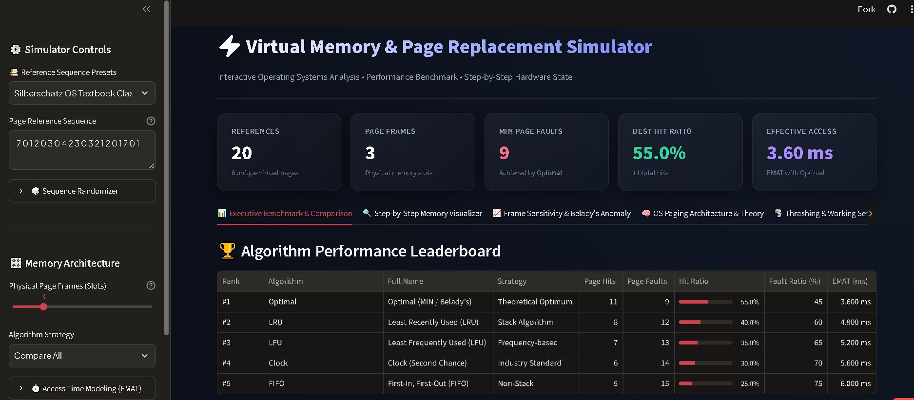
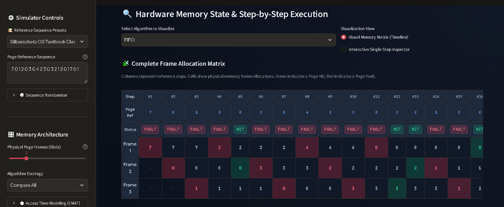
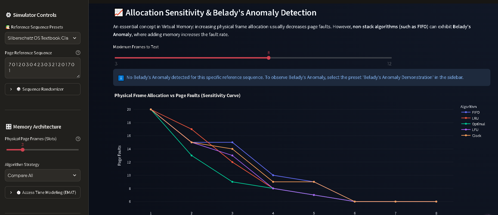
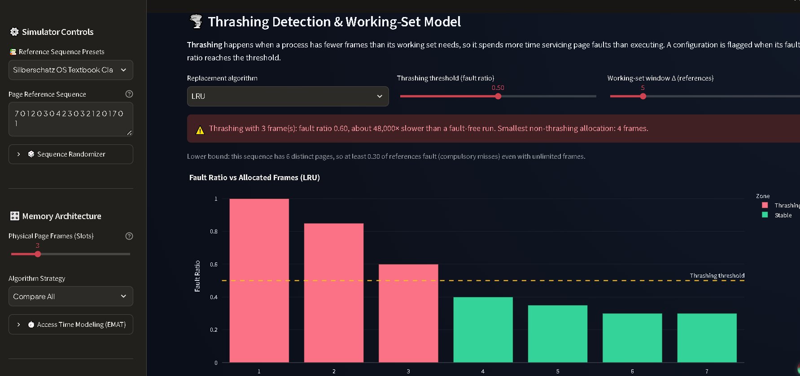
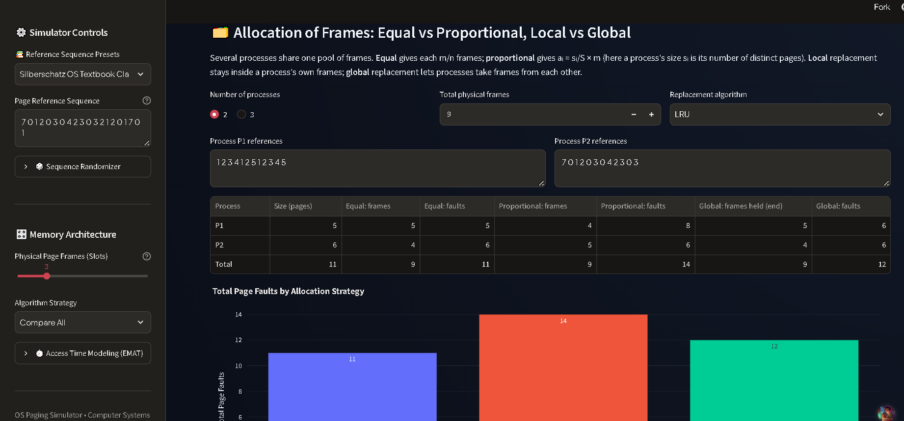
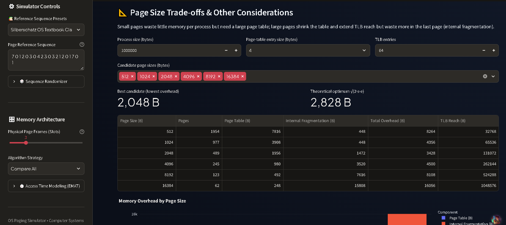

<div align="center">

# ⚡ Virtual Memory & Page Replacement Simulator

**An interactive Operating Systems tool that shows how an OS decides which memory page to evict, and what that decision costs.**


-6366F1)

### 🚀 [Live Demo](https://anshkr-virtual-memory-page-replacement-app-luua6h.streamlit.app/) &nbsp;|&nbsp; 📂 [Repository](https://github.com/Anshkr/Virtual-Memory-page-replacement)

</div>

---

## 📑 Table of Contents

- [About the Project](#-about-the-project)
- [Features](#-features)
- [Screenshots](#%EF%B8%8F-screenshots)
- [Operating System Concepts Covered](#-operating-system-concepts-covered)
- [Algorithms](#-algorithms)
- [Project Structure](#-project-structure)
- [Getting Started](#-getting-started)
- [How to Use](#-how-to-use)
- [Sample Results](#-sample-results)
- [Testing](#-testing)
- [Input Validation](#-input-validation)
- [Limitations](#-limitations)
- [Future Scope](#-future-scope)
- [Authors](#-authors)
- [References](#-references)

---

## 📖 About the Project

RAM is small and fast, the disk is large and slow, and a single **page fault** costs about **80,000 times** more than a normal memory access. When memory is full, the operating system must evict a page, and the rule it uses decides how many faults the program suffers.

This simulator lets you type (or generate) a **page reference string**, pick the number of **physical frames**, and watch five replacement algorithms handle it step by step. It measures each one with **hit ratio**, **fault ratio** and **Effective Memory Access Time (EMAT)**, and it also demonstrates the other topics of the *Virtual Memory* unit: Belady's Anomaly, thrashing, frame allocation, page size trade-offs and demand segmentation.

> Built as a Capstone Project for **Operating System (ENCS351)**

---

## ✨ Features

| | Feature | What it does |
|---|---|---|
| 🔁 | **Five replacement algorithms** | FIFO, LRU, Optimal, LFU and Clock run on the same input and are ranked on a leaderboard |
| 🔍 | **Step-by-step visualizer** | See every frame at every reference, hit or fault, the evicted page and the kernel's reason |
| 📈 | **Belady's Anomaly detector** | Sweeps the number of frames and raises an alert when more frames cause more faults |
| ⏱️ | **EMAT performance model** | Adjustable memory access time and page-fault service time |
| 🌪️ | **Thrashing & working set** | Flags frame counts that thrash and plots the working-set size over time |
| 🗂️ | **Allocation of frames** | Equal vs proportional allocation, local vs global replacement for 2–3 processes |
| 📐 | **Page size analysis** | Page-table size, internal fragmentation and TLB reach for each page size |
| 🧩 | **Demand segmentation** | Variable-size segments loaded on demand with LRU or FIFO eviction |
| 💾 | **CSV export** | Download the full step trace |
| 🛡️ | **Input validation** | Clear errors for empty, non-integer or negative input |

---

## 🖼️ Screenshots

> Add your own screenshots to `screenshots/` using the file names below.

| Benchmark & Comparison | Step-by-Step Visualizer |
|:---:|:---:|
|  |  |

| Belady's Anomaly | Thrashing & Working Set |
|:---:|:---:|
|  |  |

| Allocation of Frames | Page Size Trade-offs |
|:---:|:---:|
|  |  |

---

## 🧠 Operating System Concepts Covered

Mapped to the syllabus (Unit 3: Virtual Memory):

| Syllabus topic | Where it appears in the project |
|---|---|
| Demand paging and its performance | Pages load on first reference; EMAT with adjustable timings |
| Page-replacement algorithms | FIFO, LRU, Optimal, LFU, Clock |
| Allocation of frames | **Allocation of Frames** tab (`allocation.py`) |
| Thrashing | **Thrashing & Working Set** tab (`thrashing.py`) |
| Page size and other considerations | **Page Size & Considerations** tab (`page_size.py`) |
| Demand segmentation | **Demand Segmentation** tab (`segmentation.py`) |

**Key formula**

```
EMAT = (1 - p) x MAT + p x PFST
```

`p` = fault ratio, `MAT` = memory access time (default 100 ns), `PFST` = page-fault service time (default 8 ms).

---

## 🔬 Algorithms

| Algorithm | Evicts | Strength | Weakness |
|---|---|---|---|
| **FIFO** | The page that has been in memory longest | Very simple | Can evict useful pages; shows Belady's Anomaly |
| **LRU** | The page unused for the longest time | Exploits locality; no anomaly | Needs access-time tracking |
| **Optimal** | The page needed farthest in the future | Fewest faults possible | Needs the future, so it is only a benchmark |
| **LFU** | The page used the fewest times | Keeps popular pages | Old popular pages linger |
| **Clock** | First page with reference bit 0 (second chance) | Cheap approximation of LRU | Can show Belady's Anomaly |

Every algorithm has the same interface and returns `(results, page_hits, page_faults)`.

---

## 📁 Project Structure

```
project/
├── app.py                    # Streamlit interface, validation, charts, CSV export
├── requirements.txt
├── README.md
├── algorithms/
│   ├── fifo.py               # First-In, First-Out
│   ├── lru.py                # Least Recently Used
│   ├── optimal.py            # Optimal (Belady's MIN)
│   ├── lfu.py                # Least Frequently Used
│   ├── clock.py              # Clock (second chance)
│   ├── allocation.py         # Equal / proportional, local / global
│   ├── thrashing.py          # Thrashing detection, working-set model
│   ├── page_size.py          # Page size trade-offs
│   └── segmentation.py       # Demand segmentation
├── screenshots/
├── utils/
│   └── statistics.py         # Hit ratio, fault ratio, EMAT
└── tests/
    └── test_algorithms.py    # 26 automated tests
```

---

## 🚀 Getting Started

### Prerequisites
- Python 3.9 or later (3.10+ recommended)
- `pip` and Git

### Installation

```bash
# 1. Clone the repository
git clone https://github.com/YOUR-USERNAME/YOUR-REPO.git
cd YOUR-REPO

# 2. (Optional) create a virtual environment
python -m venv .venv
source .venv/bin/activate        # Windows: .venv\Scripts\activate

# 3. Install dependencies
pip install -r requirements.txt

# 4. Run the app
streamlit run app.py
```

The app opens at `http://localhost:8501`.

---

## 🕹️ How to Use

1. **Choose input:** pick a preset (Silberschatz textbook, Belady's Anomaly, high locality, sequential scan), type your own reference string, or generate a random one.
2. **Set frames:** use the slider (1–10).
3. **Pick an algorithm** or choose *Compare All*.
4. **Explore the tabs:**
   - 📊 *Executive Benchmark & Comparison*: leaderboard, hits vs faults, cumulative faults, EMAT
   - 🔍 *Step-by-Step Memory Visualizer*: frame contents and eviction reasons; download the CSV
   - 📈 *Frame Sensitivity & Belady's Anomaly*
   - 🧠 *OS Paging Architecture & Theory*
   - 🌪️ *Thrashing & Working Set*
   - 🗂️ *Allocation of Frames*
   - 📐 *Page Size & Considerations*
   - 🧩 *Demand Segmentation*

---

## 📊 Sample Results

### Textbook string, 3 frames
Reference string: `7 0 1 2 0 3 0 4 2 3 0 3 2 1 2 0 1 7 0 1` (20 references)

| Algorithm | Faults | Hits | Hit ratio | Fault ratio | EMAT (ms) |
|---|:---:|:---:|:---:|:---:|:---:|
| FIFO | 15 | 5 | 0.25 | 0.75 | 6.00 |
| LRU | 12 | 8 | 0.40 | 0.60 | 4.80 |
| **Optimal** | **9** | **11** | **0.55** | **0.45** | **3.60** |
| LFU | 13 | 7 | 0.35 | 0.65 | 5.20 |
| Clock | 14 | 6 | 0.30 | 0.70 | 5.60 |

*(PFST = 8 ms, MAT = 100 ns.)*

### Belady's Anomaly
Reference string: `1 2 3 4 1 2 5 1 2 3 4 5`

| Frames | 1 | 2 | 3 | 4 | 5 | 6 |
|---|:---:|:---:|:---:|:---:|:---:|:---:|
| FIFO | 12 | 12 | **9** | **10** ⚠️ | 5 | 5 |
| LRU | 12 | 12 | 10 | 8 | 5 | 5 |
| Optimal | 12 | 9 | 7 | 6 | 5 | 5 |

FIFO (and Clock) get **worse** going from 3 to 4 frames; LRU and Optimal never do.

---

## 🧪 Testing

Run the automated test suite from the project root:

```bash
python -m pytest -v
```

**26 tests** cover:
- ✅ Textbook fault counts for all five algorithms
- ✅ Boundary cases: 1 frame, a single reference, all identical pages, more frames than pages, all distinct pages
- ✅ Belady's Anomaly and the Optimal lower bound
- ✅ Statistics (including zero references) and EMAT
- ✅ Equal and proportional allocation, local and global simulation
- ✅ Thrashing detection and working-set sizes
- ✅ Page-size analysis and demand segmentation, including invalid inputs

---

## 🛡️ Input Validation

| Input | Behaviour |
|---|---|
| Empty reference string | Error message |
| `1 2 abc` or `1.5 2` | Error: integers required |
| `-3 4` | Error: non-negative integers only |
| `1,,2  3` | Accepted (commas treated as spaces) |
| Frames outside 1–10 | Prevented by the slider |
| Total frames < number of processes | Error in the Allocation tab |
| Undefined or oversized segment | Error in the Segmentation tab |

---

## ⚠️ Limitations

- It is a **simulator**: no real page tables, hardware TLB or virtual addresses.
- Frame allocation uses a process's number of distinct pages as its "size".
- Demand segmentation assumes compacted memory, so external fragmentation is not modelled.
- Dirty-page write-back cost is not modelled.
- Thrashing is detected from the fault ratio with a threshold, not from CPU utilisation.
- Optimal needs the whole future string, so it is an offline benchmark only.

---

## 🔭 Future Scope

- More algorithms: enhanced second chance, NRU, aging, ARC
- Virtual-address translation, multi-level page tables and a TLB simulator
- Dirty bits, write-back cost and prepaging
- Priority allocation and working-set / page-fault-frequency controllers
- Real memory-trace files and runtime benchmarks
- Continuous integration to run the tests on every commit

---

## 👨‍💻 Authors

| Name | Roll No. |
|---|---|
| **Ansh Kumar** | 2401730126 |
| **Ashok** | 2401730159 |

Department of Computer Science and Engineering, School of Engineering and Technology
Course: Operating System (ENCS351)

---

## 📚 References

1. A. Silberschatz, P. B. Galvin, G. Gagne, *Operating System Concepts*, 10th ed., Wiley, 2018.
2. A. S. Tanenbaum, H. Bos, *Modern Operating Systems*, 4th ed., Pearson, 2014.
3. L. A. Belady, R. A. Nelson, G. S. Shedler, "An anomaly in space-time characteristics of certain programs running in a paging machine," *Communications of the ACM*, 12(6), 1969.
4. L. A. Belady, "A study of replacement algorithms for a virtual-storage computer," *IBM Systems Journal*, 5(2), 1966.
5. P. J. Denning, "The working set model for program behavior," *Communications of the ACM*, 11(5), 1968.
6. [Streamlit docs](https://docs.streamlit.io) · [Plotly docs](https://plotly.com/python/)


